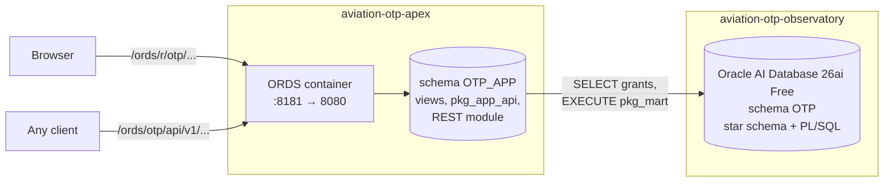

# Aviation OTP Observatory: APEX web app

**A local web application and REST API on top of the [Aviation OTP Observatory](https://github.com/Jano-Projects/aviation-otp-observatory), built with Oracle APEX and Oracle REST Data Services (ORDS).**

> 🇵🇹 *Aplicação web local do Observatório de Pontualidade Aérea, em Oracle APEX e ORDS. Guias em português: [instalação](docs/pt/guia-instalacao.md) e [construção das páginas](docs/pt/guia-paginas-apex.md).*

The observatory loads Brazil's official flight data into an Oracle star schema. This project puts a browser in front of it: punctuality by month, airline, airport, hour and day of the week, with filters, charts and a map, plus actions such as rebuilding the star schema. Everything also comes out as JSON through a REST API.

## How it fits together



- **Two repositories, one database.** This project never changes schema `OTP`. It creates its own schema, `OTP_APP`, with read access to the observatory's tables and permission to run one action (`pkg_mart`): least privilege between projects.
- **Additive measures.** The views expose sums (flights, measurable, on time, cancelled), so any filter (months, line type) gives correct percentages: `100 * sum(on_time) / sum(measurable)`, never an average of percentages.
- **The API layer commits.** The observatory's packages never commit (the caller decides). Here the caller is an HTTP request, so `pkg_app_api` ends the unit of work.
- **Same Docker network.** The ORDS container joins the observatory's network and reaches the database as `oracle:1521/FREEPDB1`; the app listens on `127.0.0.1` only.

## Quick start

Requirements: the observatory running with its star schema (`python tasks.py up`, phase 2.2 or later), Docker, Python 3.11+, about 1.5 GB more free RAM. Set up for Debian 13 and Fedora (SELinux enforcing), including VirtualBox VMs.

```bash
git clone https://github.com/Jano-Projects/aviation-otp-apex.git
cd aviation-otp-apex
python3 apex.py up        # first time: downloads and installs APEX 24.2, installs ORDS (20-30 min)
python3 apex.py install   # schema OTP_APP, views, API package, REST API, APEX workspace OTP, application
python3 apex.py check     # call the REST API
```

No Python packages are needed: `apex.py` uses only the standard library.

**First start.** `apex.py up` downloads Oracle APEX 24.2 and ORDS 26.3.1 from Oracle into `.cache/`, installs APEX with Oracle's `apexins.sql` (10-20 min) and ORDS with `ords install`, then starts the container. Every step checks the real state first, so an interrupted start resumes where it stopped. Why these versions, and why ORDS runs from a zip inside the `database/ords:24.4.0` image: [docs/architecture.md](docs/architecture.md#versions).

Then open:

- the application: `http://localhost:8181/ords/r/otp/observatorio/home` (sign in with the developer account from `.env`, `DEV` by default);
- App Builder, to change it: `http://localhost:8181/ords/`, choose Oracle APEX, workspace `OTP`.

## Versions

Tested together on Debian 13 and Fedora VirtualBox VMs without AVX2:

| Component | Version | Pinned in |
|---|---|---|
| Database (from aviation-otp-observatory) | Oracle AI Database 26ai Free 23.26.3 (`gvenzl/oracle-free:23`) | the observatory's `docker-compose.yml` |
| Oracle APEX | 24.2 (`apex_24.2_en.zip`, SHA-256 checked) | `APEX_ZIP_URL` in `apex.py` |
| ORDS | 26.3.1.303.1615 (Oracle's zip) | `ORDS_VERSION` in `apex.py` |
| Container image (Java 17 runtime) | `container-registry.oracle.com/database/ords:24.4.0` | `docker-compose.yml`, `ORDS_IMAGE` in `.env` |

## REST API

| Method | Path (under `http://localhost:8181/ords/otp/api/v1`) | Returns |
|---|---|---|
| GET | `/months` | flights, on-time %, cancelled %, average delay per month |
| GET | `/airlines?month_from=2026-01&month_to=2026-06&line_type=N` | per airline, for the filtered period |
| GET | `/airports?...` | per origin airport, with city, state and coordinates |
| GET | `/hours?...` | per hour of scheduled departure, with period of the day |
| GET | `/weekdays?...` | per day of the week |
| GET | `/runs` | the 50 latest load runs of the observatory |
| POST | `/mart/refresh?month=2026-07` | rebuilds the star schema (no `month` = every month) |

All filters are optional. `line_type`: `N` domestic, `I` international, `C` cargo, `G` other.

```bash
curl -s "http://localhost:8181/ords/otp/api/v1/airlines?line_type=N" | python3 -m json.tool | head -30
curl -s -X POST "http://localhost:8181/ords/otp/api/v1/mart/refresh?month=2026-07"
```

The POST endpoint has no authentication: the container only listens on `127.0.0.1`. Securing it with an ORDS privilege and OAuth2 is on the roadmap.

## Project layout

```
├── docker-compose.yml        ORDS container, on the observatory's network
├── apex.py                   command runner: up, install, check, refresh, urls, sql, logs, down
├── db/
│   ├── admin/                schema OTP_APP + grants, APEX workspace, invalid-object check
│   ├── app/                  indicator views, pkg_app_api (actions)
│   └── rest/                 ORDS REST module otp.api.v1
├── .cache/                   APEX installation files (downloaded, git-ignored)
├── apex/                     the exported APEX application (f100.sql), imported by install
├── docs/
│   ├── architecture.md       design, versions, first-start sequence, security
│   └── pt/                   guides in Portuguese: installation, how it works, building the pages
└── CHANGELOG.md              what changed in each version
```

## Roadmap

| Step | Scope | Status |
|---|---|---|
| 1 | APEX 24.2 + ORDS 26.3.1 in Docker, schema `OTP_APP`, views, REST API, workspace | ✅ |
| 2 | APEX pages: filters and dashboard ✅; airlines, airports map, hours and weekdays, routes, load history, actions | in progress |
| 3 | REST API secured with an ORDS privilege and OAuth2 | planned |

## Documentation

| Document | For |
|---|---|
| [docs/architecture.md](docs/architecture.md) | how the parts fit, versions and why, first-start sequence, security |
| [docs/pt/guia-instalacao.md](docs/pt/guia-instalacao.md) | installing from scratch, block by block (Portuguese) |
| [docs/pt/como-funciona.md](docs/pt/como-funciona.md) | what each file does and why (Portuguese) |
| [docs/pt/guia-paginas-apex.md](docs/pt/guia-paginas-apex.md) | building every APEX page, region by region (Portuguese) |
| [apex/README.md](apex/README.md) | the exported application and how to import or export it |
| [CHANGELOG.md](CHANGELOG.md) | what changed |

## License

MIT. Data © ANAC (open data); airport data from OurAirports (public domain).

## Author

**Victor Hugo dos Santos Correa**, Oracle PL/SQL developer. [LinkedIn](https://www.linkedin.com/in/victor-hsc)
