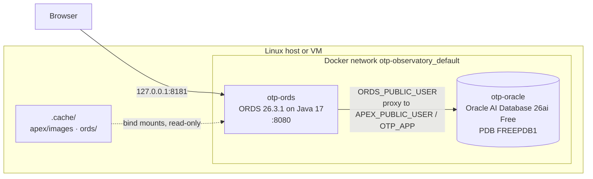

# Architecture

The web application is a second project on top of the [Aviation OTP Observatory](https://github.com/Jano-Projects/aviation-otp-observatory). It never changes the observatory's schema; it only reads it and calls one of its packages.

## Components

| Database schema | Owner of | Rights |
|---|---|---|
| `OTP` | the observatory: staging, core, star schema, PL/SQL | everything (other project) |
| `OTP_APP` | indicator views, `pkg_app_api`, REST module `otp.api.v1`, APEX application 100 | `SELECT` on 7 `OTP` tables, `EXECUTE` on `OTP.PKG_MART` only |
| `APEX_240200`, `APEX_PUBLIC_USER` | Oracle APEX 24.2 | created by `apexins.sql` |
| `ORDS_METADATA`, `ORDS_PUBLIC_USER` | ORDS | created by `ords install` |

## Versions

| Component | Version | Why this one |
|---|---|---|
| Database | Oracle AI Database 26ai Free 23.26.3 | what `gvenzl/oracle-free:23` ships today (the observatory's image) |
| Oracle APEX | 24.2 | latest at the time with a public, checksum-published download; installs on 26ai |
| ORDS | 26.3.1 | **ORDS 24.4 cannot install into 26ai**: its first check runs `select version from product_component_version where product like 'Oracle Database%'`, and 26ai calls itself *Oracle AI Database*, so the query returns no rows and the install stops with `ORA-01403`. ORDS 26.x knows 26ai and supports Java 17, 21 and 25. |
| Container image | `database/ords:24.4.0` | used only as a **Java 17 runtime**. Newer `database/ords` images are built on Oracle Linux 10, whose C library requires an x86-64-v3 CPU (AVX2); many VirtualBox VMs do not expose AVX2 (`Fatal glibc error: CPU does not support x86-64-v3`). The image's own ORDS 24.4 is not used. |

The image that used to install ORDS and APEX by itself from a `conn_string.txt` (`database/ords-developer`) now requires a login to Oracle's registry, and the plain `database/ords` image only serves (it starts empty on port 8080). Installing with Oracle's own installers keeps the project free of hidden image behaviour and of registry accounts.

## First start (`python apex.py up`)

Each step checks the real state before acting, so running `up` again after an interruption resumes where it stopped.

| # | Step | Checks first | Takes |
|---|---|---|---|
| 1 | `.cache` writable by the user | `os.access` (a folder Docker created for a bind mount belongs to root) | – |
| 2 | Download and unzip APEX 24.2 | `.cache/apex/apexins.sql` exists; SHA-256 of the zip | 1-3 min |
| 3 | Download and unzip ORDS 26.3.1 | `.cache/ords/.version` | < 1 min |
| 4 | Install APEX: copy to the database container, `@apexins.sql SYSAUX SYSAUX TEMP /i/`, unlock `APEX_PUBLIC_USER` | `DBA_REGISTRY` has `APEX` `VALID` | 10-20 min |
| 5 | Install ORDS: `ords install --admin-user SYS --proxy-user ... --password-stdin`, then `standalone.static.path` | `databases/default/pool.xml` in the config volume | < 1 min |
| 6 | Start the container and wait for HTTP | – | seconds |

With APEX already installed, `ords install` configures the PL/SQL gateway by itself (proxied to `APEX_PUBLIC_USER`).

## Application layer (`python apex.py install`)

1. `db/admin/create_app_schema.sql` (as SYS): fails with `ORA-20100` if the star schema is missing; creates `OTP_APP` and its grants.
2. `db/admin/create_apex_workspace.sql` (as SYS): fails with `ORA-20101` if APEX is not `VALID`; creates workspace `OTP` and the developer account.
3. `db/app/views.sql`, `pkg_app_api`, invalid-object check (as `OTP_APP`).
4. `db/rest/otp_api_v1.sql` (as `OTP_APP`): REST module `otp.api.v1`.
5. `apex/f100.sql`, **only if application 100 does not exist yet** (or with `--replace-app`), so pages built in App Builder are never overwritten by an older export.

All scripts are idempotent: `create or replace`, existence checks, `define_module` replacing the module.

## Design rules

- **Additive measures.** Views expose sums; percentages are computed after filtering (`100 * sum(on_time) / sum(measurable)`), never averaged.
- **Bind variables everywhere.** Filters reach SQL as binds (`:month_from`, `:P0_LINE_TYPE`) and month strings are validated by `pkg_app_api.to_month` (`ORA-20200`): no SQL injection.
- **The app layer commits.** The observatory's packages leave the transaction to the caller; here the caller is an HTTP request, so `pkg_app_api.refresh_mart` commits.

## Security

- The port is bound to `127.0.0.1`: nothing on the local network can reach the app or the API.
- `POST /mart/refresh` has no authentication yet; protecting the module with an ORDS privilege and OAuth2 is on the roadmap.
- Passwords live in `.env` (git-ignored). The SYS and `ORDS_PUBLIC_USER` passwords reach `ords install` through standard input, never the command line.
